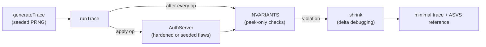

# sessionprops

Session security expressed as invariants and checked against randomly generated operation sequences, with every violation shrunk to a minimal reproduction.

[](https://github.com/SlateGitOrg/sessionprops/actions/workflows/ci.yml)

## Why

Session bugs are invisible in normal use and costly when exploited: an identifier that survives privilege elevation, a logout that only clears the client, a token that still works after a password change. Example-based tests cover the handful of sequences a developer thought of, in the order they thought of them. These bugs live in the sequences nobody wrote down, such as elevate and then replay the old identifier, or change the password and then use the session from the other device.

sessionprops states each property as something that must hold for all sequences of operations, generates sequences to try to break it, and shrinks any counterexample to the shortest trace that still fails.

## Features

- Seven session invariants, each mapped to an OWASP ASVS control: rotation on elevation, server-side logout, revocation on password change, idle timeout, absolute timeout, concurrent-session cap and unpredictable identifiers.
- A seeded, deterministic trace generator over six operations: `login`, `elevate`, `logout`, `changePassword`, `advance` (clock) and `use`.
- Delta-debugging shrinker that removes operations while the violation still reproduces.
- An in-memory reference auth server with a hardened configuration and a catalogue of seeded flaws, so detection power is measured rather than assumed.
- Non-mutating `peek*` checks so asserting an invariant never refreshes the idle window it is testing.
- Zero dependencies and no build step: TypeScript runs through Node's native type stripping.

## Architecture



`search` draws traces from a seeded generator and replays each against a fresh `AuthServer`. `runTrace` keeps a model of what it has observed (every identifier ever issued, who owns it, which were logged out, when passwords changed) and evaluates every invariant after every operation. The first failing trace is handed to `shrink`, which repeatedly drops single operations and keeps any removal that still fails. See [docs/ARCHITECTURE.md](docs/ARCHITECTURE.md) for the design decisions.

## Quick start

Requires Node 22.18 or newer (type stripping is enabled by default from 22.18; CI uses Node 24). There is nothing to install.

```bash
git clone https://github.com/SlateGitOrg/sessionprops.git
cd sessionprops
npm test        # 23 tests
npm run demo    # detection table and one shrunk bug report
```

On Node 22.6 to 22.17, prefix the commands with `NODE_OPTIONS=--experimental-strip-types`.

## Example

`npm run demo` runs the search against the hardened server and then against six servers that each carry one seeded flaw:

```
  Against a hardened server: 300 traces, 12,000 operations, no violations

  seeded flaw                     detected   trace   shrunk
  ----------------------------------------------------------------------
  NO_ROTATION_ON_ELEVATION        yes        50      2
  LOGOUT_CLIENT_SIDE_ONLY         yes        50      2
  SURVIVES_PASSWORD_CHANGE        yes        50      3
  NO_ABSOLUTE_TIMEOUT             yes        50      6
  UNLIMITED_CONCURRENT_SESSIONS   yes        50      4
  PREDICTABLE_SESSION_ID          yes        50      2

    invariant: rotation-on-elevation  (ASVS 3.3.3)
    found in a 60-step random trace, shrunk to 2 steps:

      1. login(bob)
      2. elevate(session#2)
```

A 50-step random trace becomes a 2 to 6 step bug report. The session identifier in the violation message varies between runs because the flawed server mints identifiers with `Math.random`; the trace and shrink sizes are seeded and stable.

## How it works

- **Invariants** (`src/properties.ts`) are objects with an `id`, an ASVS reference, a description and a `check(state)` that returns a violation message or `null`.
- **Elevation tracking.** On every `elevate`, all of the user's not-yet-elevated identifiers are recorded as "pre-elevation", because an attacker could already hold any of them. The invariant fails if any of them is later accepted as elevated. Identifiers that were legitimately elevated earlier are excluded, so an old elevated session is not mistaken for a rotation failure.
- **Per-user ownership.** Password-change revocation is checked per owner; without it, Alice changing her password would flag Bob's still-valid session.
- **Peek versus touch.** `AuthServer.isValid` refreshes `lastSeenAt` like a real request. Invariant checks use `peekValid`, which does not. Asserting with `isValid` would refresh every session on every check and the idle timeout could never fire.
- **Shrinking** tries removing one operation at a time and restarts after each success until no single removal still fails.
- **Reachability.** The absolute-timeout flaw is searched with shortened timeouts (60 minutes absolute, 45 minutes idle) so a short generated trace can reach them. An 8-hour window is not reachable in 50 steps, and a search that cannot reach a bug is not evidence the bug is absent.

## Testing

```bash
npm test
```

`tests/invariants.test.ts` has two layers:

- **Meta-tests**: the suite reports nothing on the hardened server over 300 traces, finds a violation on the fully vulnerable server, and detects each of six seeded flaws in isolation. The shrinker must reduce a 60-step trace to at most 8 steps, and the shrunk trace must still fail.
- **Direct invariant tests**: elevation rotates identifiers, logout is server-side, a password change revokes every session for that user only, idle and absolute timeouts fire, the concurrent cap evicts the oldest session, and identifiers are not sequential.

## Project layout

```
src/
  server.ts       reference AuthServer, HARDENED and VULNERABLE configs, seeded flaws
  properties.ts   invariants, trace generator, runTrace, shrink, search
  demo.ts         detection table and a shrunk bug report
tests/
  invariants.test.ts
docs/
  ARCHITECTURE.md
```

## Limitations

- The reference server is an in-memory simulation with a simulated clock. There is no HTTP layer, Redis store or network adapter, so the suite runs against `AuthServer` only.
- The `NO_IDLE_TIMEOUT` flaw exists in the server but is not part of the demo or the detection tests, so idle-timeout detection is not demonstrated here.
- Traces use two users (`alice` and `bob`) and a fixed operation mix.
- Not a scanner. Point a suite like this only at systems you own or are authorised to test.

## License

MIT — see [LICENSE](LICENSE).
