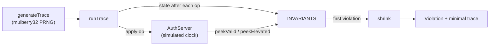

# Architecture

## Context

Session handling fails in ways that single-scenario tests do not reach: the bug appears only after a particular order of events. sessionprops treats the session lifecycle as a state machine, states the security requirements as invariants over that machine, and searches for operation sequences that violate them.

## Components

- `src/server.ts` holds `AuthServer`, an in-memory session store with a simulated clock. `ServerConfig` selects timeouts, the concurrent-session cap and a set of `Flaw` values that switch individual defects on.
- `src/properties.ts` holds the `Op` type, the `INVARIANTS` list, `runTrace` (replay plus checking), `generateTrace`, `shrink` and `search`.
- `src/demo.ts` prints the detection table and one shrunk report.

## Key decisions

**Invariants over scenarios.** Each requirement is a predicate on the observed trace (for example, "no identifier seen before an elevation is accepted as elevated afterwards"). The generator supplies the sequences, so the checks do not depend on any one scenario being written down.

**Checks must not change the system under test.** The server exposes `peekValid` and `peekElevated` that read state without refreshing `lastSeenAt`. Using the request-path `isValid` in an assertion would keep every session alive and silently disable the idle-timeout check.

**A model that records evidence.** `runTrace` tracks issued identifiers, owners, logouts, password-change times and which identifiers were elevated legitimately. Per-owner tracking avoids false positives such as flagging one user's session after another user's password change. If the server returns the same identifier on elevation, that identifier is kept as evidence rather than removed, because it is the violation.

**Seeded generation, delta-debugging shrink.** A small PRNG makes every run reproducible. Shrinking removes one operation at a time, restarting after each success. It is quadratic in trace length but traces are short, and it needs no knowledge of operation semantics.

**Seeded flaws and a hardened baseline.** The suite is validated in both directions: it must find each seeded flaw and must report nothing on the hardened configuration. A suite that always fails would pass the first check alone.

## Failure modes

- **False negative from unreachable state.** A bug that needs more steps or more elapsed time than a trace provides will not be found. The absolute-timeout search shortens the configured timeouts for this reason.
- **False positive from an incomplete model.** If the model records too little, a correct server can be flagged. The hardened-server meta-test guards this.
- **Non-minimal shrink.** Single-operation removal can stop at a local minimum. The test suite bounds the result at 8 steps for the rotation flaw.

## Out of scope

- Network transport, cookies, CSRF and token formats.
- Cryptographic strength of identifiers. The unpredictability invariant only rejects sequential identifiers.
- Distributed session stores and clock skew.
